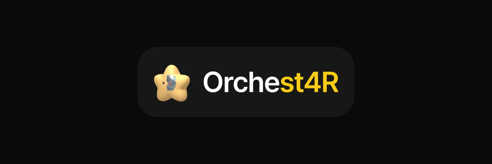
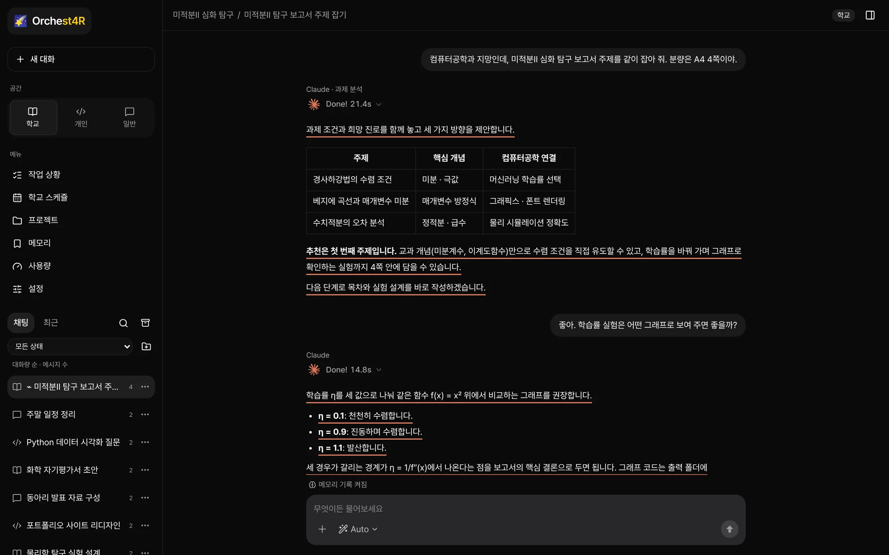
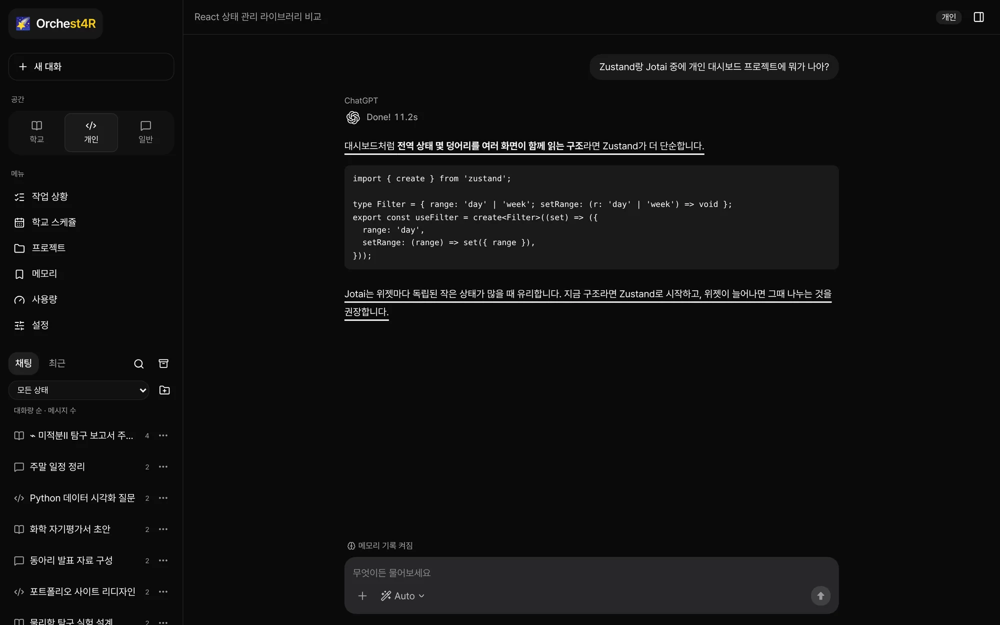
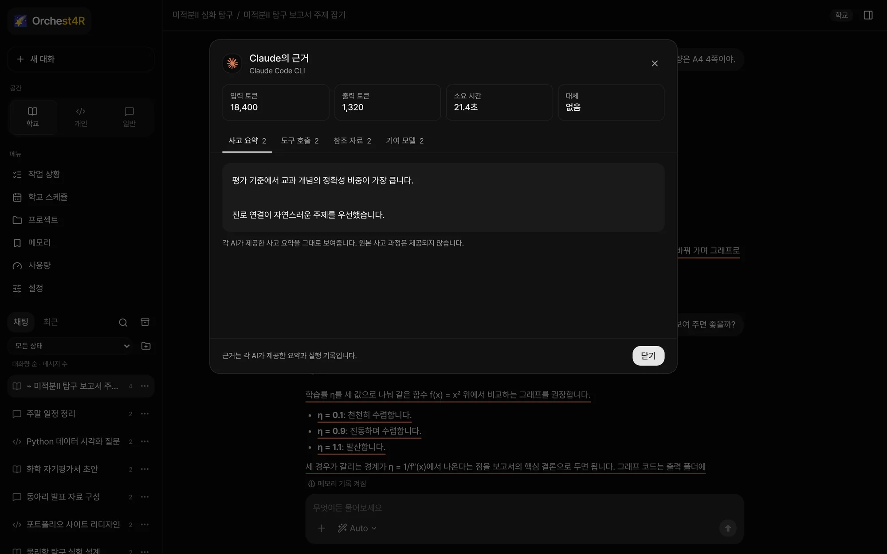
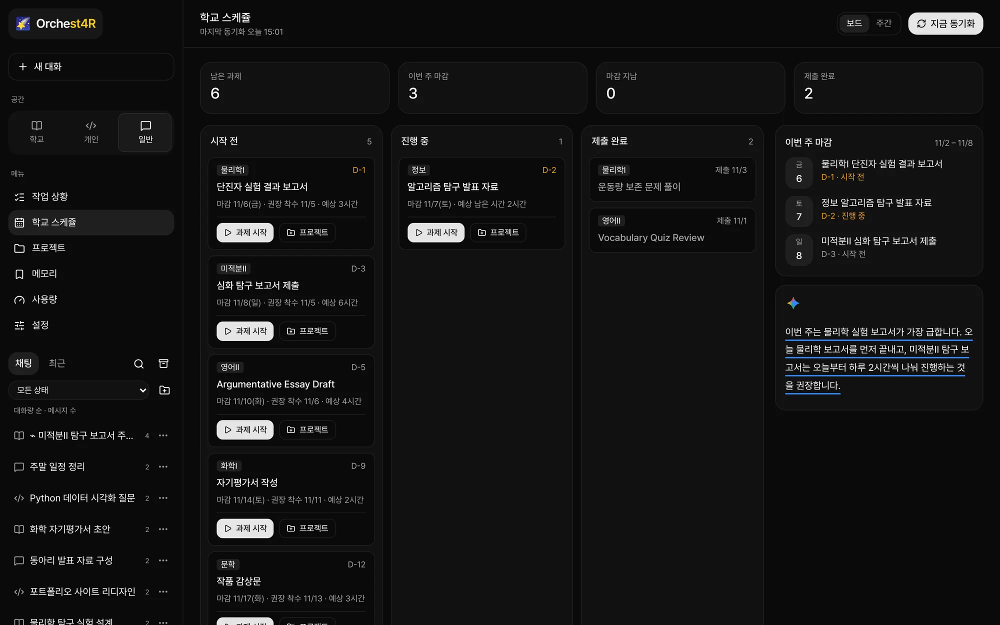
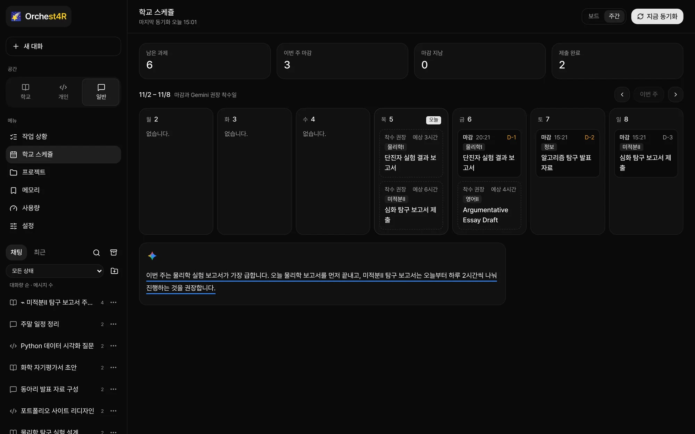
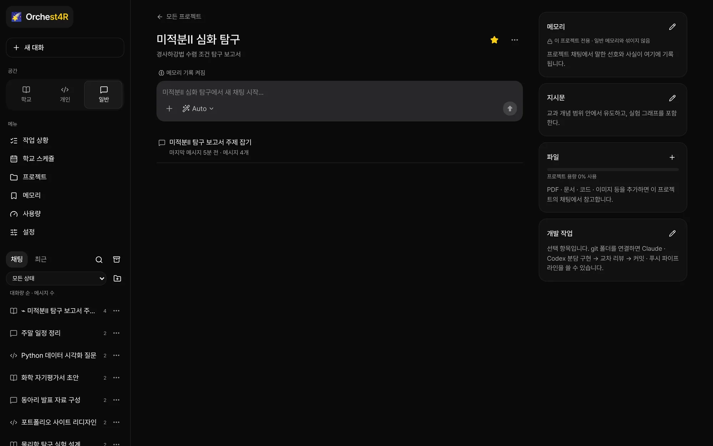
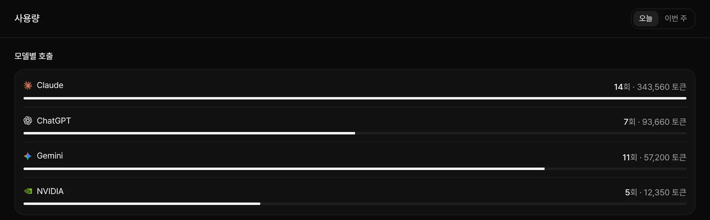

   
  
   
   
  <h3>Break your LLM Models' Limit.</h3>
  
With Claude, ChatGPT, Gemini, 50+ Nvidia Models

  

    
    
    
    
    
    
  

  

    <a href="#q1-orchest4r-프로젝트란-무엇인가요"><strong>Q1</strong></a> ·
    <a href="#q2-해당-프로젝트의-차별점이나-강점이-있다면-무엇일까요"><strong>Q2</strong></a> ·
    <a href="#q3-사용-가능한-llm-모델은-무엇이-존재하나요"><strong>Q3</strong></a> ·
    <a href="#q4-te의-모집조건-및-혜택은-어떻게-되나요"><strong>Q4</strong></a> ·
    <a href="#q5-te의-모집인원은-어떻게-되나요"><strong>Q5</strong></a> ·
    <a href="#q6-저는-qa-더-나아가-개발에-직접적으로-참여하고-싶습니다"><strong>Q6</strong></a> ·
    <a href="#q7-te의-전체적인-스케쥴-및-업무는-어떻게-되나요"><strong>Q7</strong></a> ·
    <a href="#문의-및-지원"><strong>문의 및 지원</strong></a>
  

   

<picture>
  <source media="(prefers-color-scheme: dark)" srcset="assets/chat-dark.webp">
  <source media="(prefers-color-scheme: light)" srcset="assets/chat-light.webp">
  
</picture>

안녕하십니까! 2학년 유이준입니다. 👋

이번에 개인 프로젝트 **'Orchest4R'** 를 진행하였으나, 공익을 위하여 **부분적으로 배포** 및 **"TE"** 를 모집하고자 합니다!  
(QA 형식으로 프로젝트에 대해 아래에 기술하겠습니다.)

## Q1. 'Orchest4R' 프로젝트란 무엇인가요?

단도직입적으로 말씀드리자면, **SaaS 프로젝트**입니다.

여러 LLM 모델을 유기적으로 하나의 프로그램에서 구동시킵니다!  
이해가 잘 가지 않으실 것 같아, 영상자료를 따로 첨부하였으니 해당 영상자료 확인해주세요!

<!-- 영상자료: GitHub 웹 편집 화면에서 이 줄 아래에 mp4 파일을 끌어다 놓으면 플레이어로 삽입됩니다. -->

<picture>
  <source media="(prefers-color-scheme: dark)" srcset="assets/code-dark.webp">
  <source media="(prefers-color-scheme: light)" srcset="assets/code-light.webp">
  
</picture>

## Q2. 해당 프로젝트의 차별점이나 강점이 있다면 무엇일까요?

현재 많은 LLM 모델이 존재하나, 각자의 장점과 단점이 명확히 존재합니다.  
이를 해결하기 위해 **4개 이상의 LLM 모델의 소통방식을 표준화•자동화**하였습니다.

<picture>
  <source media="(prefers-color-scheme: dark)" srcset="assets/evidence-dark.webp">
  <source media="(prefers-color-scheme: light)" srcset="assets/evidence-light.webp">
  
</picture>

또한, 단순히 여러 LLM 모델을 사용하는 것 뿐만이 아니라, **"대신고화"** 를 특별히 진행하였습니다.  
이를 통해 사용자 여러분들은 "대신고"에 알맞게 유기적으로 프로젝트를 진행할 수 있습니다.  
(Google Classroom 연동 및 모든 과제 자동화, 희망 대학 별 탐구 주제 브레인스토밍 및 고도화, 탐구 프로젝트 자동화, 기타 등등)

<picture>
  <source media="(prefers-color-scheme: dark)" srcset="assets/schedule-dark.webp">
  <source media="(prefers-color-scheme: light)" srcset="assets/schedule-light.webp">
  
</picture>

  <picture>
    <source media="(prefers-color-scheme: dark)" srcset="assets/week-dark.webp">
    <source media="(prefers-color-scheme: light)" srcset="assets/week-light.webp">
    
  </picture>
  &nbsp;
  <picture>
    <source media="(prefers-color-scheme: dark)" srcset="assets/project-dark.webp">
    <source media="(prefers-color-scheme: light)" srcset="assets/project-light.webp">
    
  </picture>

## Q3. 사용 가능한 LLM 모델은 무엇이 존재하나요?

기본적으로 다음과 같은 모델을 지원하며, individual customization이 자유롭습니다.

- **Claude**
- **ChatGPT**
- **Gemini**
- **50 + Nvidia Models** (Deepseek, Gemma, Nemotron, etc....)

<picture>
  <source media="(prefers-color-scheme: dark)" srcset="assets/usage-dark.webp">
  <source media="(prefers-color-scheme: light)" srcset="assets/usage-light.webp">
  
</picture>

## Q4. TE의 모집조건 및 혜택은 어떻게 되나요?

TE의 모집조건과 우대사항은 다음과 같습니다.

**[모집 조건]**

- AI 사용에 긍정적이며, 사용경험이 풍부하고, 유기적으로 빠르게 소통이 가능한 이

**[우대 사항]**

- LLM 모델에 대한 사전이해도가 높은 이(더 나아가, SW 그 자체도 포함.)
- UI/UX 적으로 사전이해도가 높은 이
- 2개 이상의 LLM 모델을 구독하고 있는 이

**[혜택]**

- Orchest4R Pre User
- 원하는 LLM 구독권 대여 및 구매 (추후, 최종 확정될 예정이며 최종 확정 사항이 아님.)
- 자유로운 정보 공유(SW관련 DB 공유, VB Coding 팁, SW 관련 유료 모델 공유 등)

## Q5. TE의 모집인원은 어떻게 되나요?

0명입니다.

## Q6. 저는 QA, 더 나아가 개발에 직접적으로 참여하고 싶습니다.

현재 QA 관련 업무는 계획에 존재하지 않으나, 적극적으로 지원해 주신다면 긍정적으로 검토해보겠습니다!

## Q7. TE의 전체적인 스케쥴 및 업무는 어떻게 되나요?

TE 업무는 전체적으로 **다음주 중 시작**될 예정이며, 유동적으로 변경됩니다.  
또한, 개발자와의 유기적인 소통으로 더 나은 SaaS 제품을 만들어가는 것이 주된 업무입니다.  

## Q8. 백로그는 어떻게 되나요?

기본적으로 다음과 같은 백로그가 예정되어 있으며, 유동적으로 변동됩니다.

- **생기부 작성 에이전트 제작**
- Google Classroom 과제 완전 자동화(채점기준, 양식 추가 학습 및 **AI 사용 조건 jailbreak**)
- VB Coding Guidelines 제작

## 문의 및 지원

프로젝트에 관한 모든 문의사항과 TE 지원은 아래 메일로 받고 있습니다.  
지원서의 양식은 **완전히 자율**이며, 어떠한 내용을 기술하셔도 상관 없습니다.  

  
  &nbsp;
  

<a href="mailto:contact@stx4r.me"><strong>contact@stx4r.me</strong></a>

 

  
<strong>긴 글 읽어주셔서 감사합니다.</strong>

